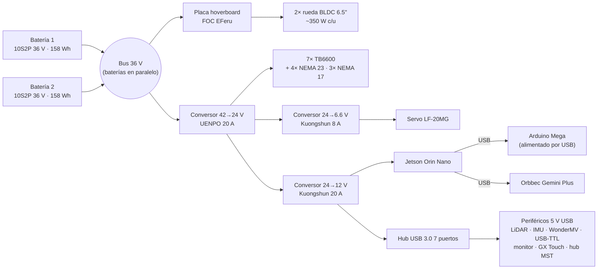

# Esquemáticos

| Archivo | Descripción |
|---|---|
| [`milo_plano_electrico.json`](milo_plano_electrico.json) | Plano completo hecho en Mesa de Cableado (rev. 1.0): 37 componentes, 137 cables |

La tabla de cableado ([`../cableado/tabla_cableado.csv`](../cableado/tabla_cableado.csv)) se genera desde este archivo con [`../herramientas/exportar_cableado.py`](../herramientas/exportar_cableado.py). La revisión del plano y los puntos pendientes están en [`../revision_plano.md`](../revision_plano.md).

## Árbol de potencia (rev. 1.0, tal como está en el plano)

## Señales de control

| Desde | Hacia | Interfaz |
|---|---|---|
| Jetson | Arduino Mega | USB |
| Jetson → hub USB → USB-TTL | Placa hoverboard | UART |
| Arduino Mega | 7× TB6600 | STEP (D2–D8), DIR (D22–D28), EN (D30–D36), cátodo común a GND |
| Arduino Mega | Servo | PWM D9 |
| Arduino Mega | MPU-9250 | I²C (D20/D21) |
| Seta de emergencia (2 NC) | Jetson pin 7 y Mega D18 | Entradas digitales |
| Jetson DisplayPort → hub MST | Monitor 11.6" y GX Touch 50 | HDMI |
